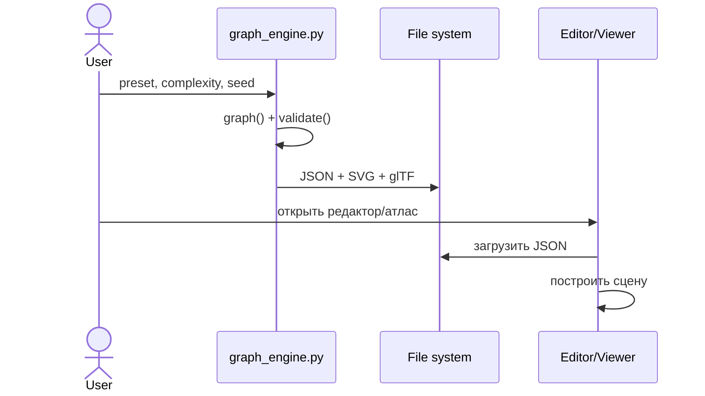

# Компонентная архитектура

## Структура репозитория

```text
keum-3d-vr/
├── index.html                    # оболочка 3D-атласа
├── src.js                        # Three.js, сцена, анимации, UI
├── serve.py                      # локальный HTTP-сервер
├── data/
│   ├── catalog.json              # рабочий каталог 412 понятий
│   └── entity_geometry_index.json
├── vector_engine/
│   ├── graph_engine.py           # граф, SVG, JSON, glTF
│   ├── generator.py              # SVG-пресеты
│   ├── editor.html               # браузерный редактор
│   ├── studio.js                 # логика редактора
│   ├── graph_exports/            # экспортированные примеры
│   └── test_graph_engine.py      # автоматические тесты
├── docs/                         # исходная спецификация v1/v2
├── mkdocs/                       # подробная документация
└── mkdocs.yml
```

## Контракты между компонентами



## Границы ответственности

- **Graph Engine:** создаёт топологию, узлы, рёбра, экспортирует форматы.
- **SVG Renderer:** отображает проекцию графа в 2D.
- **glTF Renderer:** создаёт 3D-геометрию линий.
- **3D Atlas:** визуализирует и анимирует композиции.
- **Catalog:** обеспечивает поиск и смысловые метки.
- **Documentation:** описывает математические допущения и ограничения.

## Не реализовано

Нет полноценного backend API, распределённой обработки, persistent database, синхронизации с GitHub на лету, физического солвера или автоматического точного восстановления всех 49 схем. Эти элементы нельзя считать существующими компонентами.
