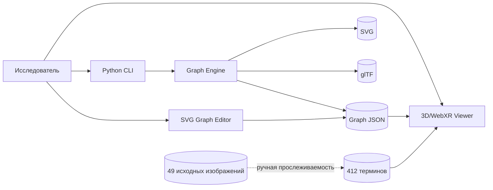

# Архитектура системы

## Контекст

KEUM состоит из двух основных подсистем: процедурного Python-движка и браузерного визуализатора на Three.js. Они используют общее понятие графа, но текущая интеграция не охватывает все потенциальные функции.

## Ключевые решения

| Решение | Мотивация | Компромисс |
|---|---|---|
| Python standard library | простая установка | ограниченные алгоритмы геометрии |
| JSON-граф | совместимость Python/JS | требуется строгая схема |
| SVG | редактируемая векторная графика | нет нативной 3D-топологии |
| glTF 2.0 | обмен с 3D-инструментами | линии не являются объёмными мешами |
| Three.js | браузерный 3D | зависимость от WebGL и CDN |
| WebXR | VR-режим | зависит от устройства, браузера, HTTPS |
| MkDocs Material | статический документационный сайт | не заменяет API-документацию кода |

## Ограничения доверия

Входные JSON и параметры редактора являются недоверенными данными. Необходимо проверять размер графа, диапазоны координат, типы, уникальность ID, отсутствие NaN/Inf и валидность SVG-атрибутов. Ссылки и внешние ресурсы не должны интерпретироваться как инструкции.

## Качество

Требования: детерминированность, тестируемость, доступность документации, переносимость файлов, трассируемость к источникам, явное обозначение неподтверждённых предположений.
