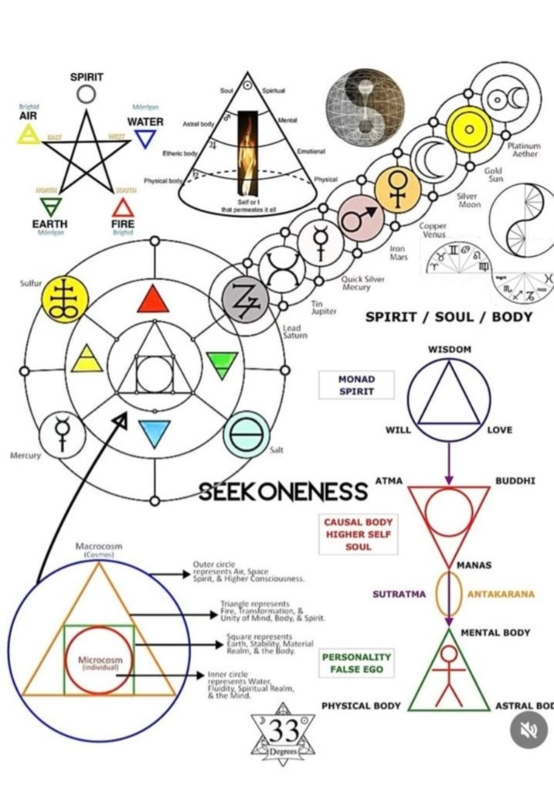
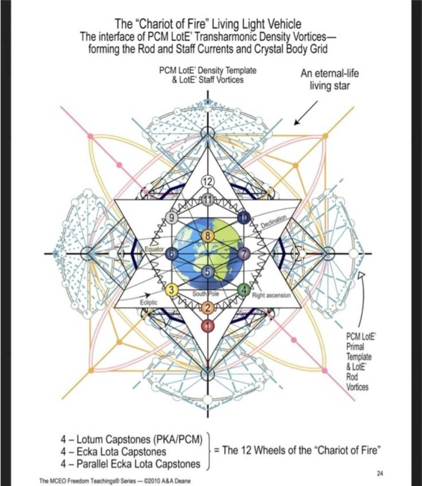
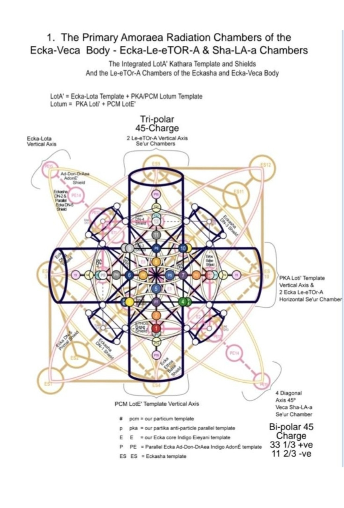
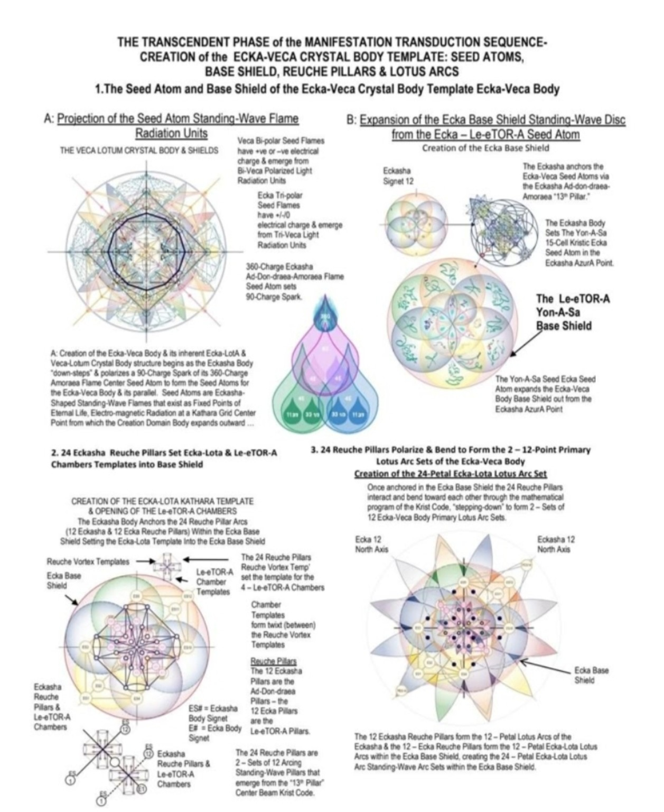
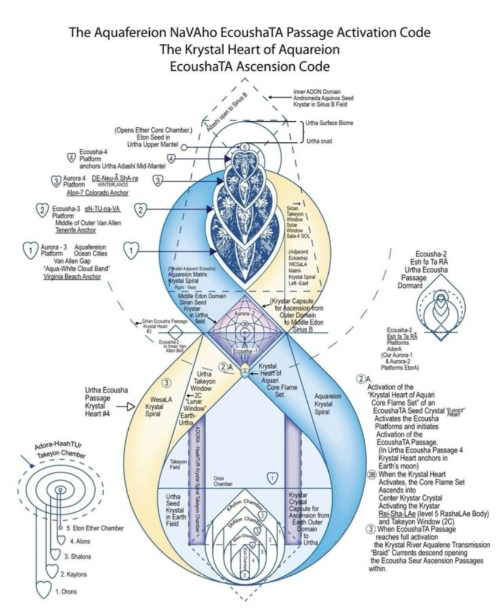
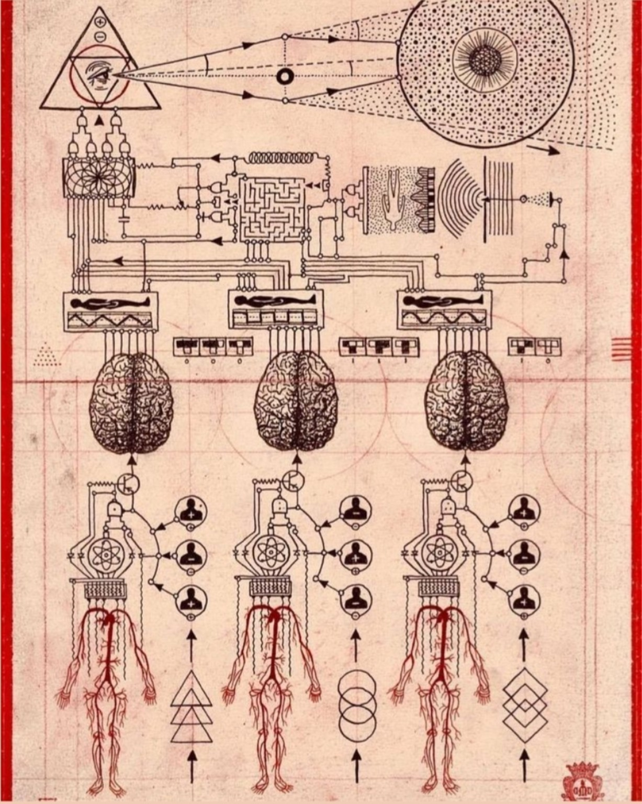
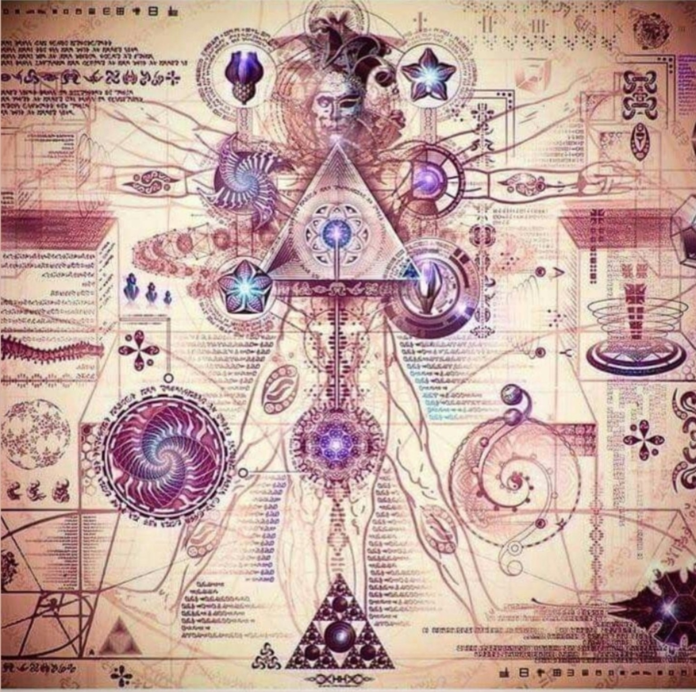
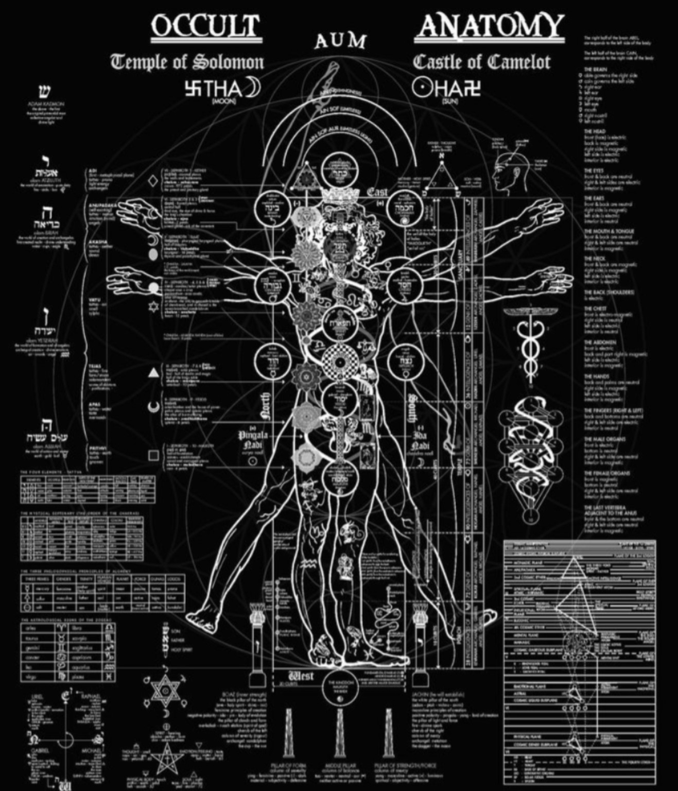
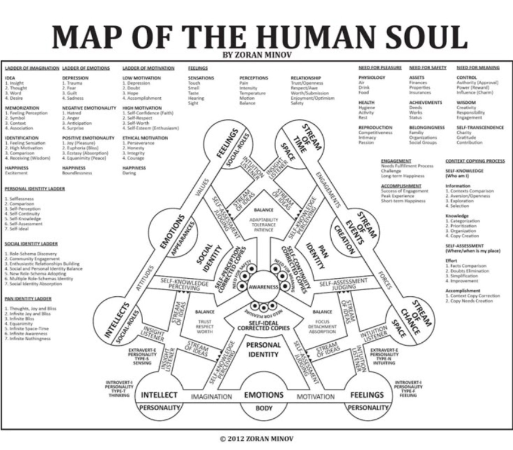
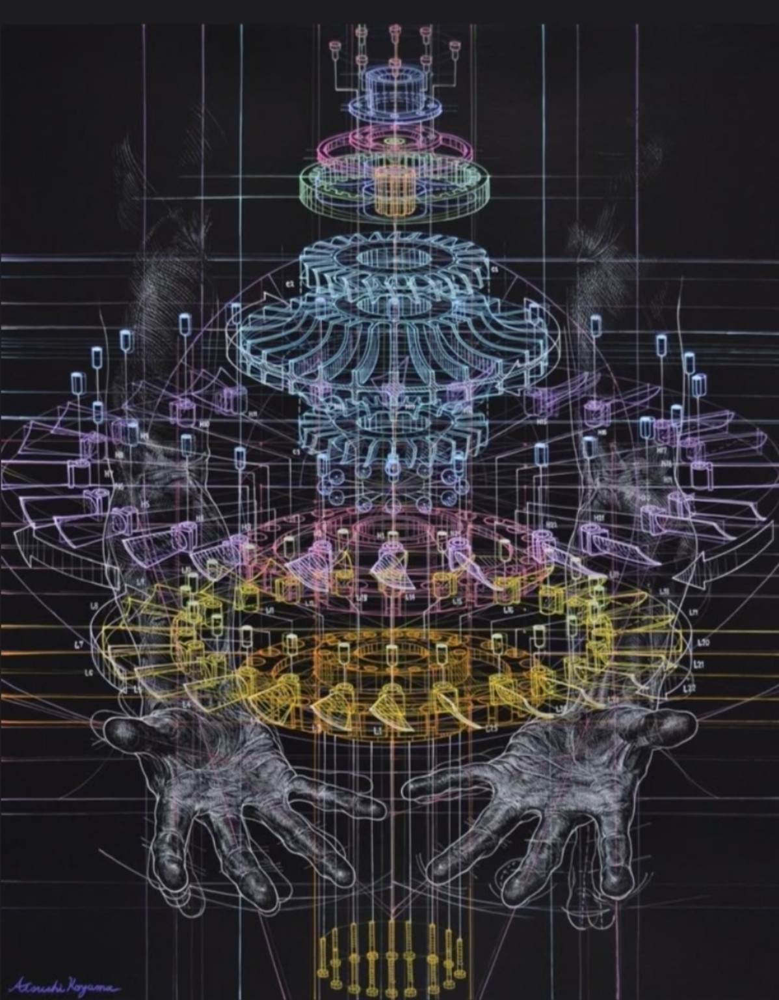

# Дополнительные 10 оригинальных схем (№ 50–59)

Добавлены **10 новых JPG** без перекодирования. Сохраняются исходные имена, SHA-256 и размеры. Они не заменяют прежний дубликат № 48: общий корпус теперь содержит **59 файловых позиций, 58 уникальных изображений**.

!!! warning "Статус"
    Приведённые ниже названия — предварительные визуальные описания, а не подтверждённая атрибуция первоисточников. Сами изображения содержат утверждения из различных эзотерических традиций; их включение не означает научного подтверждения. Ручная геометрическая и семантическая сверка ожидается.

## № 50 — 66261.jpg

**Предварительное описание:** Алхимическая и эзотерическая схема: элементы, планетарные символы, дух/душа/тело.



[Открыть исходный JPG в GitHub](https://github.com/kotenev/keum-3d-vr/blob/main/reconstruction/sources/additional_10/66261.jpg)

## № 51 — 66264.jpg

**Предварительное описание:** The Chariot of Fire: 12 Wheels, PCM LotE’ и Rod/Staff.



[Открыть исходный JPG в GitHub](https://github.com/kotenev/keum-3d-vr/blob/main/reconstruction/sources/additional_10/66264.jpg)

## № 52 — 66267.jpg

**Предварительное описание:** Amoraea Radiation Chambers: Tri-polar 45-Charge.



[Открыть исходный JPG в GitHub](https://github.com/kotenev/keum-3d-vr/blob/main/reconstruction/sources/additional_10/66267.jpg)

## № 53 — 66270.jpg

**Предварительное описание:** Ecka-Veca Crystal Body: Seed Atoms, Reuche Pillars, Lotus Arcs.



[Открыть исходный JPG в GitHub](https://github.com/kotenev/keum-3d-vr/blob/main/reconstruction/sources/additional_10/66270.jpg)

## № 54 — 66273.jpg

**Предварительное описание:** Aquafereion NaVaho EcoushaTA Passage Activation Code.



[Открыть исходный JPG в GitHub](https://github.com/kotenev/keum-3d-vr/blob/main/reconstruction/sources/additional_10/66273.jpg)

## № 55 — 66276.jpg

**Предварительное описание:** Схема взаимосвязи зрения, электрических цепей, мозга и тела.



[Открыть исходный JPG в GitHub](https://github.com/kotenev/keum-3d-vr/blob/main/reconstruction/sources/additional_10/66276.jpg)

## № 56 — 66279.jpg

**Предварительное описание:** Коллаж человеческой анатомии, спиралей и геометрических символов.



[Открыть исходный JPG в GitHub](https://github.com/kotenev/keum-3d-vr/blob/main/reconstruction/sources/additional_10/66279.jpg)

## № 57 — 66282.jpg

**Предварительное описание:** Occult Anatomy: Temple of Solomon / Castle of Camelot.



[Открыть исходный JPG в GitHub](https://github.com/kotenev/keum-3d-vr/blob/main/reconstruction/sources/additional_10/66282.jpg)

## № 58 — 66285.jpg

**Предварительное описание:** Map of the Human Soul (Zoran Minov).



[Открыть исходный JPG в GitHub](https://github.com/kotenev/keum-3d-vr/blob/main/reconstruction/sources/additional_10/66285.jpg)

## № 59 — 66288.jpg

**Предварительное описание:** Сложная цветная геометрическая структура над изображением рук.



[Открыть исходный JPG в GitHub](https://github.com/kotenev/keum-3d-vr/blob/main/reconstruction/sources/additional_10/66288.jpg)

## Воспроизводимая обработка

```bash
python3 -m pip install -r reconstruction/requirements.txt
python3 reconstruction/process_additional.py --output build/reconstruction_50_59
```

Команда создаёт для каждого из десяти оригиналов `candidates.svg`, `candidates.json`, `edges.png`, `overlay.jpg` и новый QA-манифест. Эти результаты будут **кандидатами** геометрии, не подтверждёнными реконструкциями.

[Общий манифест 59 изображений](https://github.com/kotenev/keum-3d-vr/blob/main/reconstruction/results/corpus_59.json).
