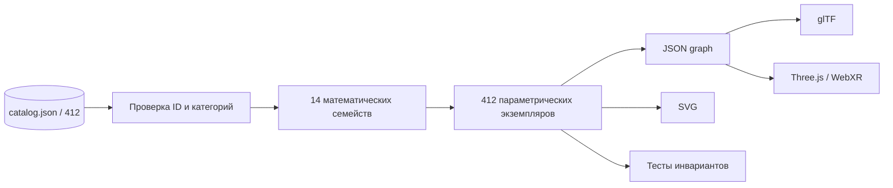

# Исполняемый атлас всех 412 концепций

## Что реализовано

В `concept_engine/runtime.py` реализован единый детерминированный движок, который загружает **все 412 сущностей** из `data/catalog.json` и строит для каждой индивидуальный вычислимый граф с координатами, рёбрами, параметрами и временным состоянием. Это программная реализация **представлений** всех 412 понятий, а не 412 независимо установленных физических законов.



## Формальные семейства

| Семейство | Уравнение или структура | Реализованное представление |
|---|---|---|
| Онтология | $G=(V,E)$ | узлы и связи |
| Геометрия | $x_i=r_i(\cos\theta_i,\sin\theta_i)$ | радиальная геометрия |
| Кинематика | $\theta_i(t)=\theta_{i0}+\omega_i t$ | вращающиеся конфигурации |
| Осцилляторы | $r_i(t)=r_0+A\sin(\omega t+\phi_i)$ | колеблющиеся радиусы |
| Графовая динамика | $G(t)$ | анимируемые графы, без ODE-решателя |
| Астрономическая визуализация | $p_i(t)\in\mathbb R^3$ | символические позиции |
| Символьная алгебра | $\mathcal C=\{c_i\}$ | индексированные элементы |
| Автоматы состояний | $s_{n+1}=T(s_n,u_n)$ | структурное представление, без семантических переходов |
| Параметрические кривые | $\gamma(t)$ | пространственные последовательности точек |
| Проекции | $x=Pq$ | 3D-точки, без полного 15D-решателя |

Параметры задаются воспроизводимо через SHA-256 от ID и названия. Это **технические параметры генератора**, а не реконструкция оригинальных численных констант.

## Запуск

```bash
python3 concept_engine/runtime.py --output build/concepts
python3 concept_engine/export_all.py --output vector_engine/graph_exports
python3 -m unittest discover -s concept_engine -p 'test_*.py'
python3 serve.py
```

После экспорта в 3D-атласе можно открыть конкретный концепт:

```text
http://localhost:8000/?graph=keum-0001
http://localhost:8000/?graph=keum-0412
```

Все 412 моделей можно просмотреть по одной, меняя четырёхзначный номер.

## Математические гарантии

Для каждого экземпляра проверяются:

$$
|V|=|\operatorname{unique}(V)|,\qquad
\forall e=(u,v)\in E:\;u,v\in V,
$$

$$
\forall p\in X(V):\;p\in\mathbb R^3,\quad
\forall p_k:\;|p_k|<\infty.
$$

При одинаковых исходных данных и времени результат детерминирован.

## Границы реализации

- Все 412 понятий представлены **структурно и геометрически**, но не все имеют уникальную динамику.
- 14 семейств — формальные категории, а не физические законы.
- Исходный реестр содержит шаблонные определения и требует индивидуальной проверки по 49 изображениям.
- Нет доказательства Concave Earth, сверхсветовых переходов, энергетической ДНК и прочих метафизических механизмов.
- Вычисление наблюдательной астрономии реализовано отдельно в `astronomy/ephemeris.py`; оно не заменяет научные эфемериды высокой точности.
- Привязка к конкретным исходным изображениям и точная метрологическая реконструкция остаются незавершёнными.

## Критерии следующего уровня

Для каждой концепции требуются отдельные поля: `source_page`, `formal_axioms`, `equations`, `units`, `initial_conditions`, `boundary_conditions`, `test_oracle`, `validation_status`. Пока эти сведения не получены из источников, их нельзя заменять вымышленными законами.
