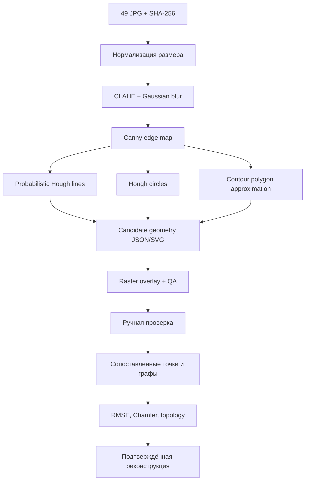

# KEUM 3.2 — геометрическая реконструкция 49 исходных изображений

## Результат этапа

Создан воспроизводимый пайплайн `reconstruction/pipeline.py` и **фактически обработаны 49 исходных JPG**. Для каждого изображения получены кандидаты геометрических примитивов, SVG, наложение на растр, карта границ и JSON с параметрами.

Опубликованы [сводный QA-отчёт](https://github.com/kotenev/keum-3d-vr/blob/main/reconstruction/results/QA_REPORT.md), [манифест всех 49 изображений](https://github.com/kotenev/keum-3d-vr/blob/main/reconstruction/results/manifest.json), примеры SVG для [первого](https://github.com/kotenev/keum-3d-vr/blob/main/reconstruction/results/example_01.svg) и [49-го](https://github.com/kotenev/keum-3d-vr/blob/main/reconstruction/results/example_49.svg) изображений. Исходные растровые изображения и полный комплект промежуточных файлов не опубликованы из-за неопределённого статуса прав на распространение.

!!! warning "Не путать с точной реконструкцией"
    Автоматически найденные линии, окружности и контуры являются **кандидатами**. В изображениях присутствуют текст, сложная графика, декоративные элементы и возможные ложные детекции. Ни одна из 49 схем пока не прошла ручную геометрическую и семантическую верификацию.

## Архитектура обработки



## Алгоритмы

### Canny

Градиенты яркости $I(x,y)$ аппроксимируются производными $I_x,I_y$, а величина градиента:

$$
G(x,y)=\sqrt{I_x(x,y)^2+I_y(x,y)^2}.
$$

Пороговая фильтрация, подавление немаксимумов и гистерезис создают карту границ.

### Прямые Хафа

Линия в нормальной форме:

$$
\rho=x\cos\theta+y\sin\theta.
$$

Probabilistic Hough Transform выдаёт конечные отрезки $(x_1,y_1,x_2,y_2)$.

### Окружности

$$
(x-a)^2+(y-b)^2=r^2.
$$

Параметры $(a,b,r)$ оцениваются алгоритмом HoughCircles и сохраняются как редактируемые кандидаты.

### Контуры

Контур аппроксимируется полилинией с ограничением отклонения от исходной последовательности пикселей. Мелкие и чрезмерно сложные полигоны отбрасываются.

## Контроль качества

Пусть $E$ — бинарная карта исходных границ, а $P$ — растеризованные кандидаты. При допуске $\varepsilon$ пикселей:

$$
\operatorname{Precision}_\varepsilon=
\frac{|P\cap\operatorname{dilate}_\varepsilon(E)|}{|P|},
$$

$$
\operatorname{Recall}_\varepsilon=
\frac{|E\cap\operatorname{dilate}_\varepsilon(P)|}{|E|},
$$

$$
F_1=\frac{2PR}{P+R}.
$$

Эта метрика показывает **совпадение обнаруженных линий с границами того же изображения**. Она не измеряет правильность подписей, топологии или соответствие авторской геометрии и не может служить доказательством точности.

## Запуск

```bash
python3 -m pip install -r reconstruction/requirements.txt
python3 -m unittest discover -s reconstruction -p 'test_*.py'
python3 reconstruction/pipeline.py \
  --sources /path/to/49/original/images \
  --output build/reconstruction --max-side 850
```

В исходном наборе файлы имели имена от `65782.jpg` до `65830.jpg`; их порядок в манифесте соответствует сортировке по числовому имени.

## Ручная проверка

Откройте [`reconstruction/review.html`](https://github.com/kotenev/keum-3d-vr/blob/main/reconstruction/review.html) локально, загрузите `candidates.json` и оригинальный растр. Можно включать/выключать группы примитивов, выбирать их, удалять ложные кандидаты и экспортировать черновик JSON.

Ручное отклонение примитива ещё **не** означает подтверждение геометрии: для статуса `verified` необходимы сопоставленные контрольные точки, проверенная топология, экспертная оценка текста и записанный протокол.

## Готовность

| Этап | Выполнено |
|---|---|
| Исходные 49 изображений обработаны | 49/49 |
| SVG-кандидаты и QA-файлы созданы | 49/49 |
| Хэши и сводный отчёт | 49/49 |
| Подтверждённые точные реконструкции | 0/49 |
| Индивидуальная проверка 412 концепций по исходникам | не завершена |

Следующий этап — интерактивная ручная разметка контрольных точек, привязка к 412 концепциям и вычисление геометрических отклонений относительно проверенных эталонов.


## KEUM 3.3 — ручная метрологическая и семантическая разметка

Добавлен [браузерный инструмент разметки](https://github.com/kotenev/keum-3d-vr/blob/main/reconstruction/manual_workbench.html). Он загружает исходный растр локально, отображает кандидатов OpenCV с корректным масштабированием, позволяет вручную размещать сопоставленные контрольные точки, линии и окружности, отменять операции, оценивать RMSE/Chamfer и экспортировать проверяемую запись `keum.manual-review.v1`.

### Проверка связей 412 концепций с изображениями

[Реестр 412 кандидатов связей](https://github.com/kotenev/keum-3d-vr/blob/main/reconstruction/results/concept_image_links_412.json) сохраняет исходные подсказки из каталога: для 77 понятий, отнесённых к изображениям 41–49, известен номер изображения из рабочего реестра; для остальных 335 точное соответствие не определено, поэтому возможный диапазон 1–40 **не объявляется подтверждённой связью**.

### Протокол верификации

1. Загрузить оригинал изображения и соответствующий `candidates.json`.
2. Выбрать конкретный `image_id` и `concept_id`, сверить термин с подписями первоисточника.
3. Внести не менее трёх пар точек «оригинал — модель» в пикселях оригинального растра.
4. Удалить ложные детекции и добавить недостающие геометрические примитивы.
5. Указать эксперта и обоснование, затем сохранить JSON разметки.
6. Проверить разметку командой:

```bash
python3 reconstruction/validate_reviews.py review_01_21.json --output build/review_results.json
```

Валидатор проверяет ID, размер изображения по опубликованному манифесту, конечность и границы координат, наличие контрольных пар, эксперта и комментария. Выдаёт RMSE и Chamfer только для допустимых наборов. **Отметка `verified` является заявлением проверяющего о геометрической разметке, а не автоматическим доказательством правильности реконструкции или научной истинности учения.**

### Статус

Автоматические кандидаты получены для 49 изображений, но ни одна схема не получила независимого ручного подтверждения. Из 412 связей 77 имеют конкретную подсказку номера рисунка, 335 остаются неразрешёнными; число подтверждённых связей равно нулю. Полный комплект исходных растров не размещён в публичном репозитории.
