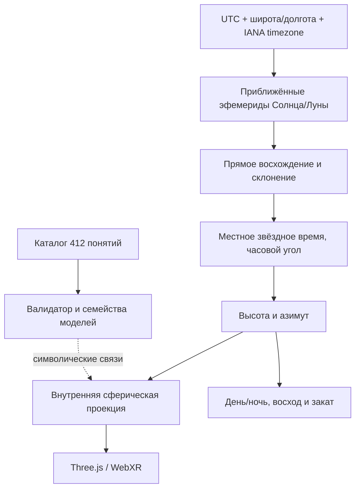

# KEUM Concave Earth Astronomy — вычислительная спецификация

## Статус реализации

Это **математически согласованная демонстрационная модель**, которая проецирует приближённые наблюдательные астрономические координаты на условную вогнутую сферическую сцену. Она **не доказывает** физическую возможность вогнутой Земли или расположения реальных светил внутри неё.

В текущем репозитории добавлены: Python-расчёт положения Солнца/Луны, азимута и высоты, восходов/закатов, временных зон и проекция на внутренние сферы; валидатор онтологии всех 412 понятий; тесты. **Полный физический солвер всех 412 «теорий» не реализован**, поскольку многие из них — названия и эзотерические образы без определённых уравнений, измерений и начальных условий.

## 1. Слои модели



Эталонный расчёт положения небесных тел отделён от геометрической интерпретации. Это позволяет независимо тестировать астрономию и визуализацию.

## 2. Время

Для UTC-момента $t$ вычисляется юлианская дата:

$$
JD=\frac{t_{\rm unix}}{86400}+2440587.5.
$$

Локальное гражданское время определяется через базу IANA `zoneinfo`, которая учитывает исторические переходы на летнее время. **Часовой пояс не определяет восход и закат**: они зависят от координат, даты и положения светила.

## 3. Экваториальные координаты

Для небесного тела $b$ используются прямое восхождение $\alpha_b$ и склонение $\delta_b$. В текущем Python-модуле солнечные координаты получаются из приближённых средних элементов с поправками на уравнение центра; лунные — из усечённого ряда периодических членов.

Для более высокой точности планируется подключить JPL DE440/DE441 или Skyfield/Astropy с явными версиями эфемерид и временными шкалами TT/TDB/UT1.

## 4. Переход в горизонтальную систему

Для географической широты $\varphi$, местного звёздного времени $\Theta$ и часового угла $H=\Theta-\alpha$:

$$
\sin h=\sin\varphi\sin\delta+
\cos\varphi\cos\delta\cos H.
$$

Азимут от севера по часовой стрелке:

$$
A=\operatorname{atan2}\left(
-\cos\delta\sin H,\,
\sin\delta\cos\varphi-\cos\delta\cos H\sin\varphi
\right).
$$

Полученные $(h,A)$ описывают наблюдаемое направление в локальной горизонтальной системе и **не требуют** предположения о вогнутой Земле.

## 5. Внутренняя проекция

Направление в осях East–Up–North:

$$
\mathbf u(h,A)=
\begin{pmatrix}
\cos h\sin A\\
\sin h\\
\cos h\cos A
\end{pmatrix}.
$$

На внутреннюю условную сферу радиуса $R_b$:

$$
\mathbf x_b=R_b\mathbf u(h_b,A_b).
$$

Радиусы в демонстрации: $R_E=29$, $R_\star=17$, $R_\odot=9.69$, $R_{\rm Moon}=13.43$. Это условные размеры, не километры и не астрономические единицы. Вся модель является **проекцией направлений** и не может одновременно представлять истинные расстояния до всех объектов.

## 6. День, ночь и сумерки

Для широты/долготы и момента UTC определяется солнечная высота $h_\odot$. Условная маска освещения:

$$
I(h)=\operatorname{clamp}\left(\frac{h+6^\circ}{12^\circ},0,1\right).
$$

Она создаёт плавный переход день/ночь, но не учитывает физическое рассеяние света, облачность, рельеф и атмосферную оптику. Для более реалистичного рендеринга потребуется атмосферная модель.

## 7. Восход и закат

Для Солнца решается уравнение:

$$
h_\odot(t)=-0.833^\circ,
$$

с приблизительной поправкой на рефракцию и видимый радиус солнечного диска. Поиск корней выполняется численно по 10-минутным интервалам с последующим делением пополам. Для Луны в демонстрации применяется грубый порог $0.125^\circ$, не учитывающий переменный горизонтальный параллакс и топоцентрические поправки. При полярном дне/ночи список пересечений может быть пустым.

## 8. 412 понятий и 14 семейств

Все 412 записей проходят проверку уникальности ID и принадлежности одной из 14 категорий. Категория получает **тип формального представления**, а не индивидуальный эмпирический закон:

| Семейство | Математический аппарат |
|---|---|
| Космология, Hova | графы и онтологии |
| Сакральная геометрия, Crystal Body | геометрические графы |
| Меркаба и поля | кинематика и матрицы вращения |
| Дыхание и циклы | осцилляторы |
| Планетарные модели | визуализация астрономических координат |
| ДНК и коды, Christos | дискретные алфавиты |
| Пламена | автоматы состояний |
| Спирали и вихри | параметрические кривые |
| Проекции и голография | линейная алгебра |
| Матрицы излучения | графовая динамика |
| Энергетическая анатомия | типизированная онтология |

Требование «математически верно со всеми 412 теориями» в буквальном смысле **неразрешимо без формального задания каждой теории**. Корректная интеграция означает отсутствие противоречий в типах, координатах и интерфейсах, а не доказательство метафизических утверждений.

## 9. Воспроизводимость и тесты

```bash
python3 -m unittest discover -s astronomy -p 'test_*.py'
python3 astronomy/ontology.py --output astronomy/ontology_412.json
python3 astronomy/ephemeris.py \
  --utc '2026-11-11T12:00:00Z' \
  --lat 55.7558 --lon 37.6173 --tz Europe/Moscow \
  --output astronomy/moscow.json
```

Тесты включают: солнечное склонение около равноденствия, высоту Солнца в Гринвиче, противоположные долготы, конечность лунных координат, норму проекции, восход/закат, локальное время, валидацию 412 записей.

## 10. Необходимые расширения

1. Высокоточные эфемериды и поправки на параллакс, рефракцию и $\Delta T$.
2. Реальные географические полигоны и динамическая текстура освещённости.
3. Астрометрические каталоги Hipparcos/Gaia, прецессия и собственные движения.
4. Расчёт фаз Луны и затмений в эталонной модели.
5. Интерфейс выбора даты, города и временной зоны.
6. Привязка каждого из 412 понятий к формальной схеме, первоисточнику и тестам.
7. Параметрические эксперименты для оценки несовместимости гипотез Concave Earth с наблюдениями.

### Главный принцип

**Внутренняя непротиворечивость программной модели не означает её физическую истинность.** KEUM может воспроизводить наблюдаемые направления, используя стандартные астрономические расчёты, но не может этим подтвердить полую Землю.
